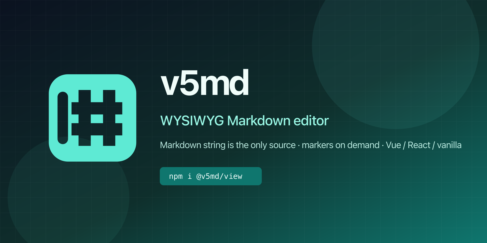

# v5md

English | [简体中文](README.md)

<p align="center">
  
</p>

[](https://github.com/zyw/v5md/actions/workflows/ci.yml)
[](https://www.npmjs.com/package/@v5md/view)
[](LICENSE)

A WYSIWYG Markdown editor. **The Markdown string is the single source of truth**: typing, pasting, and toolbar commands only mutate that string, then the document is re-parsed and re-rendered. Markdown markers appear only when the caret enters the corresponding block or inline span; when you leave, only the formatted result remains.

The same editor embeds in Vue 3 and React, or mounts on any DOM element. No framework lock-in, no takeover of your data layer, no proprietary format—what you save is standard Markdown. Built-in UI supports Simplified Chinese and English; Mermaid, mind maps, and ECharts charts come from official plugins on demand.

Current version `0.0.4` (nine packages: `core` / `view` / `vue` / `react` plus five official plugins). See [@v5md/view](https://www.npmjs.com/package/@v5md/view) on npm; the latest capabilities in this repo (localization, chart plugins, export improvements, and more) are documented here and in [`CHANGELOG.md`](CHANGELOG.md). All packages are ESM (`"type": "module"`).

## Table of contents

- [Why use it](#why-use-it)
- [Getting started](#getting-started)
- [Common API](#common-api)
- [Localization](#localization)
- [Plugins](#plugins)
- [Plugin development](#plugin-development)
- [Theme and styling](#theme-and-styling)
- [Keyboard shortcuts](#keyboard-shortcuts)
- [Parsing only](#parsing-only)
- [Browsers and dependencies](#browsers-and-dependencies)
- [FAQ](#faq)
- [Project and contributing](#project-and-contributing)

## Why use it

| | |
| --- | --- |
| **Data is Markdown** | No HTML model or private JSON. `getMarkdown()` returns a string you can store, diff, or hand to any Markdown renderer. |
| **Markers on demand** | You see formatted output; `#`, `**`, and fences appear only when the caret is on a heading, bold span, or code block, then hide again when you move away. |
| **IME-friendly** | No DOM redraw during composition, so the candidate window stays aligned and IME input does not drop characters. |
| **Paste converts** | Rich text from the web, Word, or Lark is turned into Markdown before it enters the document. |
| **Framework-agnostic** | `@v5md/vue` and `@v5md/react` are thin wrappers; the core is the `Editor` class in `@v5md/view`. |
| **Pluggable** | Toolbars, slash menu, commands, external APIs, and block renderers can all come from plugins; official plugins cover typography, export, Mermaid, Mindmap, and ECharts. |
| **zh-CN / en UI** | `locale: 'zh-CN' \| 'en'` switches built-in chrome (toolbar, slash menu, find bar, outline, …); official plugins accept the same `locale`. |

Supported content: paragraphs and headings 1–6, bold / italic / underline / strikethrough / `==highlight==` / inline code / links, ordered / bullet / task lists and blockquotes, fenced code blocks (syntax highlighting), tables (including alignment), horizontal rules, images (drag-to-resize), inline and block math (KaTeX), YAML front matter; ` ```mermaid ` / ` ```mindmap ` / ` ```echarts ` are rendered by the matching official plugins.

Editing features: undo/redo, find & replace (regex and whole word), full-document source mode with highlighting and line numbers, outline navigation, sticky toolbar/outline, block drag handle and block menu, table row/column editing, image upload and resize, one-click copy as WeChat rich text, and plugin extensions.

### How it works

```text
Type / paste / toolbar / shortcuts
        │
        ▼
  Mutate Markdown string (with undo history)
        │
        ▼
  micromark / mdast → offset-aware node tree
        │
        ▼
  Re-render document region only; restore caret at offset
```

Selection uses string offsets `{ anchor, head }`, not DOM `Range`. `marker` nodes correspond to source tokens like `#`, `**`, and fences; offsets match the source exactly so the view knows when to paint markers.

## Getting started

### Installation

Install from the public npm registry—no login or private registry required. Pick packages for your stack. Swap in `pnpm` or `yarn` as needed; package names stay the same.

```bash
# Vue 3 — pulls in @v5md/view and @v5md/core
npm install vue @v5md/vue

# React — same; you supply react and react-dom
npm install react react-dom @v5md/react

# Vanilla JS / other frameworks
npm install @v5md/view

# Parse Markdown only, no UI
npm install @v5md/core

# Optional — typography, export, Mermaid, Mindmap, ECharts are separate installs
npm install @v5md/plugin-typography @v5md/plugin-export @v5md/plugin-mermaid @v5md/plugin-mindmap @v5md/plugin-echarts
```

| Package | When to install |
| --- | --- |
| [`@v5md/vue`](https://www.npmjs.com/package/@v5md/vue) | Vue 3 apps. Peer dependency: `vue@^3.4` |
| [`@v5md/react`](https://www.npmjs.com/package/@v5md/react) | React apps. Peer dependencies: `react`, `react-dom` 18 or 19 |
| [`@v5md/view`](https://www.npmjs.com/package/@v5md/view) | Direct `new Editor()`. Framework packages depend on it; you usually do not declare it again |
| [`@v5md/core`](https://www.npmjs.com/package/@v5md/core) | `parse`, outline, or edit state only—no editor instance |
| [`@v5md/plugin-typography`](https://www.npmjs.com/package/@v5md/plugin-typography) | Adjust body font size |
| [`@v5md/plugin-export`](https://www.npmjs.com/package/@v5md/plugin-export) | Export Markdown, HTML, PDF, or images |
| [`@v5md/plugin-mermaid`](https://www.npmjs.com/package/@v5md/plugin-mermaid) | Render `mermaid` diagrams |
| [`@v5md/plugin-mindmap`](https://www.npmjs.com/package/@v5md/plugin-mindmap) | Render `mindmap` diagrams |
| [`@v5md/plugin-echarts`](https://www.npmjs.com/package/@v5md/plugin-echarts) | Render `echarts` fenced charts |

Import the theme once in app code or you get structure without typography:

```ts
import '@v5md/view/theme.css'
```

KaTeX and lowlight ship with `@v5md/view`; `katex/dist/katex.min.css` is pulled in by the `@v5md/view` entry. Mermaid / Mindmap / ECharts stay in their plugin packages.

If `~/.npmrc` sets `@v5md:registry` to a corporate registry, installs go there instead of npmjs.org. Remove that line for the public registry. For corporate registry steps, see [发布教程](发布教程.md).

After install:

1. Import `@v5md/view/theme.css` once site-wide.
2. Vue: use `V5Editor` with `v-model` below. React: `value` / `onChange`. Other stacks: `new Editor({ element })`.
3. For typography, export, or charts, install the matching plugin and pass it via `plugins` or `editor.use()`—see [Plugins](#plugins). For UI language, see [Localization](#localization).

### Vue 3

`V5Editor` two-way-binds Markdown via `v-model`.

```vue
<script setup lang="ts">
import { ref, shallowRef } from 'vue'
import type { Editor } from '@v5md/view'
import { V5Editor } from '@v5md/vue'
import { createMermaidPlugin } from '@v5md/plugin-mermaid'
import '@v5md/view/theme.css'

const markdown = ref('# Title\n')
const editor = shallowRef<Editor | null>(null)
const locale = ref<'zh-CN' | 'en'>('en')
const plugins = [createMermaidPlugin({ locale: locale.value })]
</script>

<template>
  <V5Editor
    v-model="markdown"
    :locale="locale"
    placeholder="Start writing…"
    :plugins="plugins"
    :on-upload-image="(file) => URL.createObjectURL(file)"
    :on-ready="(instance) => (editor = instance)"
  />
  <button type="button" @click="editor?.undo()">Undo</button>
</template>
```

| Prop | Description |
| --- | --- |
| `v-model` / `modelValue` | Full Markdown. Replacing with a different string from outside resets the document and undo history |
| `placeholder` | Empty-document hint; omit to use the locale default |
| `locale` | `'zh-CN'` (default) or `'en'`; updates call `setLocale()` |
| `editable` | Editable when `true` (default); `false` is read-only preview—task checkboxes still toggle in preview |
| `plugins` | Plugin array; see [Plugins](#plugins) |
| `onUploadImage` | Called on image pick or paste; return URL or `Promise<string>` |
| `onPickImage` | Called when the toolbar image button is clicked; return `false` to use the system file picker |
| `onFindRequest` | Receives find/replace on Mod+F / Mod+H; omit to use the built-in bar |
| `onReady` | `Editor` instance after mount |

The component calls `destroy()` on unmount. The root has class `v5md-host`; your `class` and attributes land on that element.

### React

`V5Editor` is controlled via `value` and `onChange`; the editor is created once on mount.

```tsx
import { useState } from 'react'
import type { Editor } from '@v5md/view'
import { V5Editor } from '@v5md/react'
import { createMermaidPlugin } from '@v5md/plugin-mermaid'
import '@v5md/view/theme.css'

export function Page() {
  const [markdown, setMarkdown] = useState('# Title\n')
  const [locale] = useState<'zh-CN' | 'en'>('en')
  const [, setEditor] = useState<Editor | null>(null)

  return (
    <V5Editor
      value={markdown}
      onChange={setMarkdown}
      locale={locale}
      placeholder="Start writing…"
      plugins={[createMermaidPlugin({ locale })]}
      onReady={setEditor}
      onUploadImage={(file) => URL.createObjectURL(file)}
    />
  )
}
```

| Prop | Description |
| --- | --- |
| `value` / `onChange` | Current Markdown and change handler |
| `placeholder` | Empty-document hint; omit to use the locale default |
| `locale` | `'zh-CN'` (default) or `'en'`; updates call `setLocale()` |
| `className` | Applied on the host (which also has `v5md-host`) |
| `editable` | Editable when `true` (default) |
| `plugins` | Plugin array |
| `onUploadImage` / `onPickImage` / `onFindRequest` / `onReady` | Same as Vue |

Later changes to `editable`, `placeholder`, and `locale` sync to the instance; other callbacks are read at creation only (refs forward updates without rebuilding the editor). When switching language and plugin button labels must update, rebuild plugins with the new `locale` (e.g. `key={locale}` on the component).

### Vanilla JS / other frameworks

Place an empty element, then construct `Editor`:

```ts
import { Editor } from '@v5md/view'
import { createEchartsPlugin } from '@v5md/plugin-echarts'
import '@v5md/view/theme.css'

const editor = new Editor({
  element: document.querySelector('#editor')!,
  value: '# Title\n\nBody',
  locale: 'en',
  placeholder: 'Start writing…',
  toolbar: true,
  outline: true,
  plugins: [createEchartsPlugin({ locale: 'en' })],
  onChange(markdown) {
    localStorage.setItem('draft', markdown)
  },
  onUploadImage(file) {
    return URL.createObjectURL(file)
  },
})

// on teardown
editor.destroy()
```

`toolbar` and `outline` default to visible; pass `false` to hide, or toggle later with `setToolbarVisible()` / `setOutlineVisible()`. `toolbarSticky` / `outlineSticky` control pin-on-scroll (toolbar off by default, outline on); use `setToolbarSticky()` / `setOutlineSticky()` to change at runtime.

## Common API

### Creation options `EditorOptions`

| Option | Type | Default | Description |
| --- | --- | --- | --- |
| `element` | `HTMLElement` | required | Host element |
| `value` | `string` | `''` | Initial Markdown |
| `placeholder` | `string` | — | Empty-document hint; omit to use the current locale default |
| `locale` | `'zh-CN' \| 'en' \| string` | `'zh-CN'` | Built-in UI language (toolbar, slash menu, find bar, outline, table bar, block menu, …) |
| `toolbar` | `boolean` | `true` | Show toolbar |
| `outline` | `boolean` | `true` | Show outline |
| `toolbarSticky` | `boolean` | `false` | Pin toolbar while scrolling |
| `outlineSticky` | `boolean` | `true` | Pin outline while scrolling |
| `lineNumbers` | `boolean` | `true` | Line numbers in source mode |
| `editable` | `boolean` | `true` | `false` = read-only preview |
| `plugins` | `V5mdPlugin[]` | — | Plugins installed at creation |
| `onChange` | `(markdown: string) => void` | — | Document change callback |
| `onUploadImage` | `(file: File) => string \| Promise<string>` | — | Image upload; result becomes `` |
| `onPickImage` | `() => void \| false` | — | Custom image button; `false` keeps system picker |
| `onFindRequest` | `(request: { kind: 'find' \| 'replace' }) => void` | — | Handle Mod+F / Mod+H |

### Localization

Built-in chrome defaults to **Simplified Chinese** and can switch to **English**. Coverage: toolbar, slash menu, find/replace bar, outline, table controls, block menu, task/image `aria-label`s, link hover hints, and the empty-document `placeholder` when you do not set one.

```ts
import { Editor } from '@v5md/view'
import { createMermaidPlugin } from '@v5md/plugin-mermaid'
import { createMindmapPlugin } from '@v5md/plugin-mindmap'
import { createEchartsPlugin } from '@v5md/plugin-echarts'
import { createExportPlugin } from '@v5md/plugin-export'

const locale = 'en'

const editor = new Editor({
  element,
  locale,
  plugins: [
    createExportPlugin({ locale, title: 'My note' }),
    createMermaidPlugin({ locale }),
    createMindmapPlugin({ locale }),
    createEchartsPlugin({ locale }),
  ],
})

editor.setLocale('zh-CN')
editor.getLocale() // 'zh-CN'
```

| Capability | Notes |
| --- | --- |
| `locale` option | `'zh-CN'` / `'en'`; values like `zh` or `en-US` normalize to those two |
| `setLocale()` / `getLocale()` | Switch / read at runtime; refreshes built-in chrome |
| Vue / React `locale` | Prop changes sync to the instance |
| Official plugin `locale` | Mermaid / Mindmap / ECharts / Export labels, status text, and default templates follow the language |

Plugin labels are written at **install** time. `editor.setLocale()` alone does not rewrite already-installed plugin buttons—rebuild plugins with the new `locale` when switching (playground remounts with `:key="locale"`). Full docs: [`README.md`](README.md) (Chinese) / [`README.en.md`](README.en.md) (English).

### Reading and writing content

| Method | Description |
| --- | --- |
| `getMarkdown()` | Full document |
| `setMarkdown(markdown)` | Replace all content and reset undo history |
| `insertText(text)` | Insert at caret; returns whether the document changed |
| `replaceSelection(text)` | Replace current selection |
| `wrapSelection(before, after?)` | Wrap selection; `after` defaults to `before` |
| `focus()` / `focusAt(offset)` | Focus, or move caret to string offset and scroll into view |

Selection is always `{ anchor, head }` string offsets, not a DOM `Range`—safe to snapshot and restore anytime.

### Format commands

```ts
editor.format('heading2')   // block format toggle
editor.toggleBold()         // inline format
```

`format(command)` accepts: `code`, `table`, `orderedList`, `bulletList`, `taskList`, `quote`, `heading1`, `heading2`, `heading3`, `rule`, `link`, `math`, `inlineMath`. Headings, lists, and quotes toggle—run again to revert.

Inline helpers: `toggleBold()`, `toggleItalic()`, `toggleUnderline()`, `toggleCode()`, `toggleStrikethrough()`, `toggleHighlight()`.

Block commands are ignored inside code blocks, math blocks, and YAML; in tables, all block commands except links are ignored.

### Find and replace

| Method | Description |
| --- | --- |
| `openFind()` | Open built-in find bar |
| `findNextMatch(query, options?, direction?, advance?)` | Find next; returns `{ hit, error }` |
| `replaceNextMatch(query, replacement, options?)` | Replace current match |
| `replaceAllMatches(query, replacement, options?)` | Replace all |
| `selectFindMatch(from, to)` | Select range and scroll into view |

`FindOptions`: `caseSensitive`, `wholeWord`, `regexp`. Highlights use CSS `::highlight()`; unsupported browsers degrade silently.

### View and state

| Method | Description |
| --- | --- |
| `setSourceMode(on)` / `toggleSourceMode()` / `isSourceMode()` | Full-document source mode |
| `setLineNumbersVisible(on)` / `isLineNumbersVisible()` | Source mode line numbers |
| `setToolbarVisible(on)` / `isToolbarVisible()` | Toolbar visibility |
| `setOutlineVisible(on)` / `isOutlineVisible()` | Outline visibility |
| `setToolbarSticky(on)` / `isToolbarSticky()` | Pin toolbar on scroll (default off) |
| `setOutlineSticky(on)` / `isOutlineSticky()` | Pin outline on scroll (default on) |
| `setEditable(on)` | Toggle read-only at runtime |
| `setPlaceholder(text)` | Change placeholder at runtime |
| `setLocale(locale)` / `getLocale()` | Switch / read built-in UI language (`zh-CN` / `en`) |
| `getOutline()` | Headings as `{ depth, text, start }[]` |
| `getPluginState()` | Snapshot: `markdown`, `selection`, `path`, `editable`, `sourceMode`, `findOpen`, etc. |
| `getHostElement()` / `getContentElement()` | Host / content elements |

### Export and clipboard

| Method | Description |
| --- | --- |
| `getWechatHtml(options?)` | Inline-styled HTML for WeChat paste. `options.baseUrl` resolves relative image URLs; defaults to current page URL |
| `copyForWechat()` | Generate and copy; returns success |
| `toWechatHtml(markdown, { baseUrl? })` | Pure function variant |
| `copyRichText(html, text)` | Write HTML and plain text to clipboard |
| `htmlToMarkdown(html)` | HTML → Markdown for paste pipeline |

Normal copy and WeChat copy differ: WYSIWYG mode copies rendered content (no Markdown markers); source mode copies full Markdown.

### Mounting toolbar and outline separately

To place the toolbar outside the editor (e.g. a top bar):

```ts
import { createOutline, createToolbar, createToolbarFromItems } from '@v5md/view'

const bar = createToolbar(
  (command) => editor.runCommand(command), // built-in command ids
  (file) => editor.insertImageFile(file),
)
document.querySelector('#my-toolbar')!.append(bar)

const outline = createOutline((offset) => editor.focusAt(offset))
outline.update(editor.getOutline())
```

`createToolbarFromItems(items, onCommand, onImage, onPickImage?)` takes a custom button list with the same shape as `V5mdToolbarItem` in plugins.

## Plugins

Plugins can contribute toolbar buttons, slash menu items, externally callable commands, block renderers, and plugin-owned APIs. You can ship any subset—for example API only, no UI.

### Official plugins

Official plugins are separate installs; the editor does not bundle them:

```bash
npm install @v5md/plugin-typography @v5md/plugin-export @v5md/plugin-mermaid @v5md/plugin-mindmap @v5md/plugin-echarts
```

| Package | Role | Toolbar / slash |
| --- | --- | --- |
| [`@v5md/plugin-typography`](packages/plugins/typography/README.md) | Body font size | None |
| [`@v5md/plugin-export`](packages/plugins/export/README.md) | Export Markdown / HTML / PDF / images | None |
| [`@v5md/plugin-mermaid`](packages/plugins/mermaid/README.md) | ` ```mermaid ` diagrams | Optional “Flowchart” toolbar / slash item |
| [`@v5md/plugin-mindmap`](packages/plugins/mindmap/README.md) | ` ```mindmap ` outline diagrams | Optional “Mind map” toolbar / slash item |
| [`@v5md/plugin-echarts`](packages/plugins/echarts/README.md) | ` ```echarts ` JSON charts | Optional “Chart” toolbar / slash item |

Typography and export are API-only; Mermaid / Mindmap / ECharts include insert UI by default—set `toolbar: false` to hide toolbar buttons. Every plugin accepts `locale` to match the editor language. The Vue / React playgrounds wire chart plugins and zh-CN/en switching; see [`playground-vue/src/App.vue`](playground-vue/src/App.vue).

### Typography plugin

```ts
import { createTypographyPlugin } from '@v5md/plugin-typography'

const typography = editor.use(createTypographyPlugin({ defaultSize: 16 }))
typography.api.setFontSize(18)   // out-of-range throws RangeError
typography.api.resetFontSize()
```

| Option | Default | Description |
| --- | --- | --- |
| `defaultSize` | — | Font size (px) applied on install |
| `minSize` / `maxSize` | `10` / `40` | Allowed range |
| `name` | `typography` | Plugin name for `requires` and `getPlugin` |

API: `setFontSize(px)`, `getFontSize()`, `resetFontSize()`, `getDefaultSize()`.

### Mermaid plugin

```ts
import { createMermaidPlugin } from '@v5md/plugin-mermaid'

const editor = new Editor({
  element,
  locale: 'en',
  plugins: [createMermaidPlugin({ locale: 'en' })],
})

await editor.runCommand('mermaid.insert')
// or type /Flowchart (Chinese UI uses 流程图)
```

| Option | Default | Description |
| --- | --- | --- |
| `locale` | `zh-CN` | Toolbar / slash labels and drawing status text |
| `toolbar` | `true` | Show insert button |
| `lang` | `mermaid` | Matched fenced lang |
| `template` | simple flowchart | Default source for insert |

Without the plugin, `mermaid` fences render as ordinary highlighted code. Details: [`packages/plugins/mermaid/README.md`](packages/plugins/mermaid/README.md).

### Mindmap plugin

```ts
import { createMindmapPlugin } from '@v5md/plugin-mindmap'

const editor = new Editor({
  element,
  plugins: [createMindmapPlugin({ locale: 'en', height: 360 })],
})

await editor.runCommand('mindmap.insert')
```

Fence body is a Markdown outline (headings or indented lists). `locale` affects button labels, status text, and the default template. Details: [`packages/plugins/mindmap/README.md`](packages/plugins/mindmap/README.md).

### ECharts plugin

```ts
import { createEchartsPlugin } from '@v5md/plugin-echarts'

const editor = new Editor({
  element,
  plugins: [createEchartsPlugin({ height: 320, locale: 'en' })],
})

await editor.runCommand('echarts.insert')
```

Fence body must be JSON option (no JS execution). `locale` affects button labels, validation errors, and the default option template. See [`packages/plugins/echarts/README.md`](packages/plugins/echarts/README.md) and [`docs/plugin-block-render.md`](docs/plugin-block-render.md).

### Export plugin

```ts
import { createExportPlugin } from '@v5md/plugin-export'

const exporter = editor.use(createExportPlugin({
  fileName: 'note',
  title: 'My document',
  locale: 'en',
}))

await exporter.api.downloadPdf('note')        // download PDF
const html = await exporter.api.exportHtml()  // full HTML (with chart snapshots)
exporter.api.downloadMarkdown('note')         // download .md
```

| Option | Default | Description |
| --- | --- | --- |
| `fileName` | `v5md-document` | Default filename prefix |
| `title` | follows `locale`: `v5md 文档` / `v5md document` | HTML export `<title>` |
| `locale` | `zh-CN` | Affects default `title` |
| `imageScale` | `2` | Screenshot scale |
| `pdfMargin` | `24` | PDF margin (pt) |
| `renderer` | — | Replace html2canvas / jsPDF for tests or custom renderers |

API: `exportMarkdown()`, `exportHtml()`, `exportHtmlFragment()`, `exportImage(options?)`, `exportPdf(options?)`, `print()`, `downloadMarkdown()`, `downloadHtml()`, `downloadImage()`, `downloadPdf()`.

`exportHtml()` keeps rendered KaTeX / Mermaid SVG and **snapshots ECharts (and other canvas charts) to images** so clones are not blank. `downloadPdf()` is image-based PDF (Chinese and charts stay intact) with smart page breaks at block boundaries; for selectable vector text use `print()` and the browser “Save as PDF” path. Details: [`packages/plugins/export/README.md`](packages/plugins/export/README.md).

### Install, invoke, and uninstall

```ts
import { Editor } from '@v5md/view'
import { createExportPlugin } from '@v5md/plugin-export'

// 1) At creation
const editor = new Editor({ element, plugins: [createExportPlugin()] })

// 2) At runtime — returns handle
const handle = editor.use(createExportPlugin())
await handle.ready              // resolves after async setup
handle.api.downloadMarkdown()   // plugin API
handle.dispose()                // uninstall: cleanup + destroy

// 3) Lookup by name
editor.getPlugin('export')?.api

// 4) Run plugin or built-in commands
await editor.runCommand('export.downloadMarkdown')
```

`use()` is idempotent: same name + same instance returns the same handle; same name + different instance throws. `editor.destroy()` uninstalls all plugins in reverse order.

## Plugin development

### Plugin object

```ts
import type { V5mdPlugin } from '@v5md/view'

interface WordCountApi {
  count(): number
}

export function createWordCountPlugin(): V5mdPlugin<WordCountApi> {
  return {
    name: 'word-count',
    version: '0.1.0',
    apiVersion: 1,
    api: (context) => ({
      count: () => context.editor.getMarkdown().replace(/\s+/g, '').length,
    }),
  }
}
```

| Field | Description |
| --- | --- |
| `name` | Required, unique; npm package name recommended |
| `version` | Plugin version, optional |
| `apiVersion` | Must equal `PLUGIN_API_VERSION` (currently `1`) or install fails |
| `requires` | Required peer plugins; must already be installed |
| `optional` | Optional peers; not validated—use `getPlugin` inside the plugin |
| `commands` | `Record<string, { run, isEnabled? }>` |
| `toolbar` | Toolbar button definitions |
| `slash` | `/` menu items; selection clears `/query` then runs `command` |
| `blocks` | Custom fenced block renderers (charts, mind maps, etc.)—see below |
| `api` | Object exposed to consumers |
| `setup` | Called after mount; return value is cleanup (may be a Promise) |
| `destroy` | Called on uninstall |

### Commands and state

`run(context, ...args)` receives:

| Field | Description |
| --- | --- |
| `context.editor` | `Editor` instance—for live data |
| `context.host` | Host element |
| `context.state` | Snapshot at command time (`markdown`, `selection`, `path`, `editable`, `sourceMode`, `findOpen`, `toolbarVisible`, `outlineVisible`) |
| `context.insertText` / `replaceSelection` / `wrapSelection` | Controlled editing |
| `context.focus()` | Focus content |

`path` is leaf-to-root from the caret—useful to test blockquote / list / table context.

```ts
commands: {
  'callout.toggle': {
    isEnabled: (state) => !state.sourceMode,
    run: ({ editor }) => {
      editor.format('quote')
    },
  },
}
```

### Add a toolbar button

```ts
import type { V5mdPlugin } from '@v5md/view'

const ICON = '<svg viewBox="0 0 24 24" width="16" height="16" fill="none" stroke="currentColor" stroke-width="2"><path d="M4 12h16M9 12V7M9 17v-5"/></svg>'

export function createQuoteButtonPlugin(): V5mdPlugin {
  return {
    name: 'quote-button',
    commands: {
      'quote.toggle': {
        run: ({ editor }) => editor.format('quote'),
      },
    },
    toolbar: [
      {
        command: 'quote.toggle',
        label: 'Quote',
        icon: ICON,
        group: 'block',    // built-in groups: block / list / quote / heading / insert / inline / action
        order: 80,         // lower = earlier within group
        type: 'toggle',    // toggle sets aria-pressed from isActive
        isActive: (state) => state.path.some((node) => node.type === 'blockquote'),
        isDisabled: (state) => !state.editable,
      },
    ],
  }
}
```

Button fields:

| Field | Required | Description |
| --- | --- | --- |
| `command` | yes | Command id on click; must be registered |
| `label` | yes | Button label; also shown in overflow “More” menu |
| `icon` | yes | Trusted SVG / HTML string—only your own markup |
| `id` | no | Defaults to `command`; globally unique |
| `group` | no | Default `plugin:<name>`; built-in groups slot into regions: `block`, `list`, `quote`, `heading`, `insert`, `inline`, `action` |
| `order` | no | Ascending within group; default is declaration order |
| `type` | no | `action` (default) or `toggle`; `toggle` sets `aria-pressed` from `isActive` |
| `isActive` / `isDisabled` | no | Snapshot callbacks for highlight / disabled |
| `shortcut` | no | Metadata only—does not register a real keybinding |

The toolbar collapses overflow into “More”; plugin and built-in buttons share ordering.

### Lifecycle

```text
new Editor({ plugins })  →  install: validate name / apiVersion / requires / id conflicts
editor.use(plugin)       →  install: registry, then setup
setup(context)           →  return value registered as cleanup
handle.ready             →  when setup returns a Promise, resolve before use
handle.dispose()         →  cleanup() → destroy() → remove from registry, rebuild toolbar
editor.destroy()         →  uninstall all plugins in reverse order
```

### Constraints

- Duplicate plugin names (different instances) throw. **Built-in command ids cannot be overridden:** `code`, `table`, `orderedList`, `bulletList`, `taskList`, `quote`, `heading1`, `heading2`, `heading3`, `rule`, `link`, `math`, `inlineMath`, `bold`, `italic`, `underline`, `inlineCode`, `strike`, `highlight`, `wechat`.
- Command ids are globally unique—first install wins.
- Toolbar `id` (default `command`) is globally unique; `command` must exist (built-in or another plugin).
- `requires` plugins must be installed first; `setup` errors roll back install and propagate.
- `context.state` is a snapshot—do not hold long-term; use `context.editor` for live data.
- Toolbar `shortcut` does not register keybindings; extend `editor/keymap.ts` for new chords.

Design notes: [`docs/plugin-design.md`](docs/plugin-design.md).

### Custom block rendering (charts / mind maps)

Plugins use `blocks` to handle fenced code for a given `lang`. Between full re-renders the host reuses instances by

`rendererId:lang:hash(source):occurrence`

and calls `hydrate` / `update` / `destroy`.

```ts
import {
  createFencedWidgetShell,
  type V5mdPlugin,
} from '@v5md/view'

export function createDemoBlockPlugin(): V5mdPlugin {
  return {
    name: 'demo-block',
    blocks: [
      {
        id: 'demo',
        lang: 'demo',
        render(ctx) {
          const { root, preview } = createFencedWidgetShell(ctx.node, {
            blockClass: 'v5-demo',
            placeholder: 'Rendering…',
          })
          preview.dataset.source = ctx.source
          return root
        },
        async hydrate(ctx) {
          if (!ctx.isCurrent() || ctx.signal.aborted) return
          const preview = ctx.element.querySelector<HTMLElement>('[data-void="widget"]')
          if (preview) preview.textContent = ctx.source
        },
      },
    ],
  }
}
```

Conventions:

- Preview slot uses `data-void="widget"` (or `diagram`), `contentEditable="false"`
- Inactive shows preview, active shows source (`v5-widget` class recommended; `createFencedWidgetShell` adds it)
- Lookup: plugin registry → ordinary code block (`mermaid` needs `@v5md/plugin-mermaid`)
- Frozen interfaces and roadmap: [`docs/plugin-block-render.md`](docs/plugin-block-render.md)

## Theme and styling

Theme is a single CSS file: `@v5md/view/theme.css`. Import wholesale or fold into your build.

Conventions:

- Selectors start with `.v5md`; classes use the `v5-` prefix; body rules live under `.v5md .v5-doc`, so host page globals do not leak in.
- The editor chrome has no border radius, so it nests cleanly in rounded containers.

Override from `.v5md`:

```css
.v5md .v5-doc {
  font-size: 16px;
  line-height: 1.8;
}

.v5md .v5-doc h1 {
  font-size: 28px;
}

.v5md .v5-toolbar {
  background: #fafafa;
}
```

Prefer tweaking colors, font size, and spacing. Indent, `display`, and `content` pseudo-elements underpin caret mapping—changing them can cause caret jumps.

## Keyboard shortcuts

`Mod` is ⌘ on macOS and Ctrl elsewhere.

| Key | Action |
| --- | --- |
| `Mod+B` / `Mod+I` / `Mod+U` | Bold / italic / underline |
| `Mod` + backtick | Inline code |
| `Mod+~` or `Mod+Shift+X` | Strikethrough |
| `Mod+=` or `Mod+Shift+H` | Highlight |
| `Mod+K` | Link |
| `Mod+Shift+K` / `Mod+Shift+T` | Code block / table |
| `Mod+Shift+[` / `Mod+Shift+]` | Ordered / bullet list |
| `Mod+Shift+O` / `Mod+Shift+Q` | Task list / blockquote |
| `Mod+1` / `Mod+2` / `Mod+3` | Heading 1 / 2 / 3 |
| `Mod+Z` / `Mod+Shift+Z` / `Mod+Y` | Undo / redo |
| `Mod+F` / `Mod+H` | Find / replace |
| `Mod+Shift+S` | Source mode |
| `Tab` / `Shift+Tab` | Move between table cells, else indent / outdent |
| `Enter` / `Shift+Enter` | New block / soft line break |

In read-only preview, only find shortcuts apply.

## Parsing only

When you need parse/edit without the UI, use `@v5md/core`. No DOM dependency—runs in Node.

```ts
import { createState, outline, parse, plainText } from '@v5md/core'

const tree = parse('# Title\n\nBody')      // node tree with start / end offsets
const headings = outline('# Title\n\n## Next')
const text = plainText(tree.children[0]!)  // plain text without markers
const state = createState('# Title\n')       // edit state + undo history
```

Parsing uses micromark / mdast with GFM strikethrough, tables, task lists, YAML front matter, and math; empty lines become empty paragraphs, `<u>` becomes `underline`, `==...==` becomes `highlight`.

Edit helpers are pure: state in, new state out (document, selection, history). Full list: [`packages/core/README.md`](packages/core/README.md).

## Browsers and dependencies

- Targets modern browsers (recent two major versions of Chrome / Edge / Safari / Firefox). Uses `contenteditable`, Clipboard API, CSS Highlights. Without Highlights, find highlighting and rich clipboard degrade; editing still works.
- All packages are ESM—use Vite, webpack 5, Rollup, esbuild, or native `import`.
- KaTeX and lowlight ship with `@v5md/view`; Mermaid / Mindmap / ECharts load with their plugins when charts appear in the document.
- Building this repo needs Node.js `^20.19.0` or `>=22.12.0` (Vite 7); runtime has no Node version requirement.

## FAQ

**What to store?** The Markdown string from `onChange` / `v-model` is the full document—persist or send as-is.

**Read-only display?** `editable: false`. Same editor; math, charts, and tables still render; tasks remain checkable.

**Get the instance?** `onReady` in Vue / React; in vanilla code, the return value of `new Editor()`.

**Image upload?** `onUploadImage(file)` returns a URL or `Promise<string>`; empty string skips insert. Override the button with `onPickImage`; return `false` to keep the system file picker.

**SSR?** You can import modules, but the editor mounts only in the browser (Vue `onMounted`, React `useEffect`). Show a placeholder on first paint.

**Custom toolbar?** `createToolbarFromItems()` with your buttons; a plugin that only defines `toolbar`; or `setToolbarVisible(false)` and call `editor.runCommand()` from UI elsewhere.

**Switch language?** Pass `locale: 'en'` or `'zh-CN'` at creation, or call `setLocale()` later; Vue / React use the `locale` prop. Chart plugins need the same `locale` (or a remount) so their button labels update too.

**Charts?** Install `@v5md/plugin-mermaid` / `mindmap` / `echarts` and put them in `plugins`. Fence langs are `mermaid`, `mindmap`, and `echarts`; you can also insert via slash menu or toolbar.

**Will the editor corrupt content?** Only edited regions are rewritten; untouched spans stay as-is. You can `parse()` before write if you want a sanity check.

## Project and contributing

| Package | Description |
| --- | --- |
| [`@v5md/core`](packages/core/README.md) | Markdown parse and edit—no DOM |
| [`@v5md/view`](packages/view/README.md) | `contenteditable` editor, toolbar, outline, theme |
| [`@v5md/vue`](packages/vue/README.md) | Vue 3 component |
| [`@v5md/react`](packages/react/README.md) | React component |
| [`@v5md/plugin-typography`](packages/plugins/typography/README.md) | Typography plugin |
| [`@v5md/plugin-export`](packages/plugins/export/README.md) | Export plugin |
| [`@v5md/plugin-mermaid`](packages/plugins/mermaid/README.md) | Mermaid plugin |
| [`@v5md/plugin-mindmap`](packages/plugins/mindmap/README.md) | Mindmap plugin |
| [`@v5md/plugin-echarts`](packages/plugins/echarts/README.md) | ECharts plugin |

Dependency graph: `core ← view ← {vue, react, plugin-*}`.

Local development:

```bash
npm install
npm run typecheck   # tsc -b
npm run lint
npm test
npm run dev:vue     # http://localhost:5173
npm run dev:react   # http://localhost:5174
```

Conventions for layout, naming, comments, and commits: [`CONTRIBUTING.md`](CONTRIBUTING.md). Build and publish: [发布教程](发布教程.md). Release notes: [`CHANGELOG.md`](CHANGELOG.md). CI on GitHub Actions runs lint, format:check, typecheck, build, and test.

## License

[MIT License](LICENSE) © 2026 zhuyanwei. Use, modify, and redistribute freely (including commercially); retain copyright and license text when redistributing.
