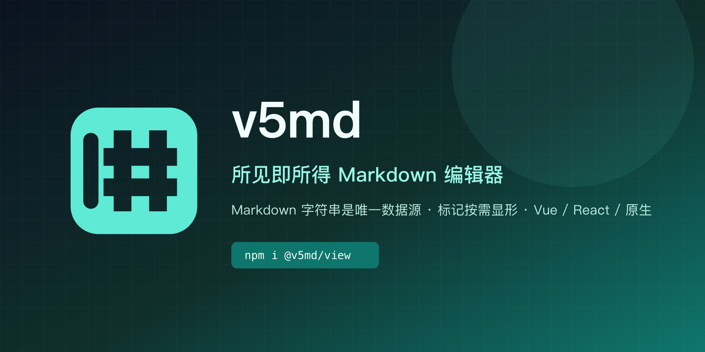

# v5md

[English](README.en.md) | 简体中文

<p align="center">
  
</p>

[](https://github.com/zyw/v5md/actions/workflows/ci.yml)
[](https://www.npmjs.com/package/@v5md/view)
[](LICENSE)

所见即所得 Markdown 编辑器。**Markdown 字符串是唯一数据源**：输入、粘贴和工具条命令都只改这段字符串，再重新解析、重绘页面。光标进入某个块或行内格式时才显示对应 Markdown 标记，离开后只保留排版结果。

同一套编辑器可以嵌进 Vue 3 和 React，也可以直接挂到任意 DOM 元素上。不依赖框架、不接管你的数据流、不生成私有格式——存下来的就是标准 Markdown。内置界面支持简体中文与英文；流程图、思维导图、ECharts 图表通过官方插件按需接入。

当前版本 `0.0.5`（九个包：`core` / `view` / `vue` / `react` 与五个官方插件）。npm 上见 [@v5md/view](https://www.npmjs.com/package/@v5md/view)；仓库最新能力（国际化、图表插件、导出增强等）以本 README 与 [`CHANGELOG.md`](CHANGELOG.md) 为准。所有包均为 ESM（`"type": "module"`）。

## 目录

- [为什么用它](#为什么用它)
- [快速开始](#快速开始)
- [常用 API](#常用-api)
- [语言（国际化）](#语言国际化)
- [插件](#插件)
- [插件开发](#插件开发)
- [主题与样式](#主题与样式)
- [快捷键](#快捷键)
- [只做解析](#只做解析)
- [浏览器与依赖](#浏览器与依赖)
- [常见问题](#常见问题)
- [项目与贡献](#项目与贡献)

## 为什么用它

| | |
| --- | --- |
| **数据就是 Markdown** | 没有 HTML 模型和私有 JSON。`getMarkdown()` 拿到的是可以直接入库、走 diff、交给别的 Markdown 渲染器的字符串。 |
| **标记按需显形** | 平时看到的是排版结果；光标落在标题、粗体、代码块上时才露出 `#`、`**`、围栏，改完自动收回去。 |
| **中文输入法友好** | 组合输入期间不重绘 DOM，不会出现候选框错位、拼音上屏丢字。 |
| **粘贴即转换** | 从网页、Word、飞书复制的富文本，先转成 Markdown 再写入文档。 |
| **不锁死框架** | `@v5md/vue`、`@v5md/react` 只是薄壳，核心是 `@v5md/view` 里的 `Editor` 类。 |
| **可插拔** | 工具条、斜杠菜单、命令、对外 API、块渲染都能由插件提供；官方插件覆盖字号、导出、Mermaid、Mindmap 和 ECharts。 |
| **中英界面** | `locale: 'zh-CN' \| 'en'` 切换工具条、斜杠菜单、查找栏、大纲等内置文案；官方插件也可传同一 `locale`。 |

支持的内容：段落与一到六级标题、粗体/斜体/下划线/删除线/`==高亮==`/行内代码/链接、有序列表/无序列表/任务列表/引用、围栏代码块（语法高亮）、表格（含对齐）、分割线、图片（可拖拽缩放）、行内公式与公式块（KaTeX）、文首 YAML frontmatter；` ```mermaid ` / ` ```mindmap ` / ` ```echarts ` 由对应官方插件按需渲染。

编辑能力：撤销重做、查找替换（支持正则与全词）、带语法高亮和行号的整篇源码模式、大纲跳转、工具条/大纲钉顶、块级拖拽与块菜单、表格行列编辑、图片上传与缩放、一键复制为公众号富文本、插件扩展。

### 工作方式

```text
输入 / 粘贴 / 工具条 / 快捷键
        │
        ▼
  改 Markdown 字符串（带撤销历史）
        │
        ▼
  micromark / mdast 解析成带偏移的节点树
        │
        ▼
  只重绘文档区，并把光标放回对应偏移
```

选区用字符串偏移 `{ anchor, head }` 表示，不是 DOM Range；`marker` 节点对应 `#`、`**`、围栏这些源码符号，偏移与原文严格一致，视图据此决定何时把标记画出来。

## 快速开始

### 安装

从 npm 官方仓库安装，不需要登录，也不需要配置私有源。按用法选一个装。`pnpm`、`yarn` 换对应的安装命令即可，包名相同。

```bash
# Vue 3。会同时装上 @v5md/view 和 @v5md/core
npm install vue @v5md/vue

# React。同样会带上 view 和 core；react、react-dom 要自己装
npm install react react-dom @v5md/react

# 原生 JS / 其他框架
npm install @v5md/view

# 只解析 Markdown，不画页面
npm install @v5md/core

# 可选。字号、导出、Mermaid、Mindmap、ECharts 都要单独装，编辑器不会自带
npm install @v5md/plugin-typography @v5md/plugin-export @v5md/plugin-mermaid @v5md/plugin-mindmap @v5md/plugin-echarts
```

| 包 | 什么时候装 |
| --- | --- |
| [`@v5md/vue`](https://www.npmjs.com/package/@v5md/vue) | Vue 3 项目。peer dependency 是 `vue@^3.4` |
| [`@v5md/react`](https://www.npmjs.com/package/@v5md/react) | React 项目。peer dependency 是 `react`、`react-dom` 18 或 19 |
| [`@v5md/view`](https://www.npmjs.com/package/@v5md/view) | 直接 `new Editor()`。框架包依赖它，一般不用再单独声明 |
| [`@v5md/core`](https://www.npmjs.com/package/@v5md/core) | 只要 `parse`、大纲或编辑状态，不创建编辑器 |
| [`@v5md/plugin-typography`](https://www.npmjs.com/package/@v5md/plugin-typography) | 要改正文字号 |
| [`@v5md/plugin-export`](https://www.npmjs.com/package/@v5md/plugin-export) | 要导出 Markdown、HTML、PDF 或图片 |
| [`@v5md/plugin-mermaid`](https://www.npmjs.com/package/@v5md/plugin-mermaid) | 要渲染 `mermaid` 流程图 |
| [`@v5md/plugin-mindmap`](https://www.npmjs.com/package/@v5md/plugin-mindmap) | 要渲染 `mindmap` 思维导图 |
| [`@v5md/plugin-echarts`](https://www.npmjs.com/package/@v5md/plugin-echarts) | 要渲染 `echarts` 围栏图表 |

主题要在业务代码里引入一次，否则只有结构没有排版：

```ts
import '@v5md/view/theme.css'
```

KaTeX、lowlight 随 `@v5md/view` 一起安装，不用额外处理；`katex/dist/katex.min.css` 由 `@v5md/view` 入口自动引入。Mermaid / Mindmap / ECharts 留在对应插件包里按需安装。

本机 `~/.npmrc` 里如果写了 `@v5md:registry` 指向公司仓库，上面的安装会走那个地址，而不是 npmjs.org。使用官方仓库时删掉这一行。从公司仓库安装的步骤见 [发布教程](发布教程.md)。

装好之后：

1. 全站引入一次 `@v5md/view/theme.css`。
2. Vue 用下一节的 `V5Editor` 和 `v-model`。React 用 `value` / `onChange`。其他框架用 `new Editor({ element })`。
3. 要用字号、导出或图表时，再安装对应插件，传给 `plugins` 或 `editor.use()`，见[插件](#插件)。界面语言见[语言（国际化）](#语言国际化)。

### Vue 3

`V5Editor` 用 `v-model` 双向绑定 Markdown。

```vue
<script setup lang="ts">
import { ref, shallowRef } from 'vue'
import type { Editor } from '@v5md/view'
import { V5Editor } from '@v5md/vue'
import { createMermaidPlugin } from '@v5md/plugin-mermaid'
import '@v5md/view/theme.css'

const markdown = ref('# 标题\n')
const editor = shallowRef<Editor | null>(null)
const locale = ref<'zh-CN' | 'en'>('zh-CN')
const plugins = [createMermaidPlugin({ locale: locale.value })]
</script>

<template>
  <V5Editor
    v-model="markdown"
    :locale="locale"
    placeholder="开始编写…"
    :plugins="plugins"
    :on-upload-image="(file) => URL.createObjectURL(file)"
    :on-ready="(instance) => (editor = instance)"
  />
  <button type="button" @click="editor?.undo()">撤销</button>
</template>
```

| 属性 | 说明 |
| --- | --- |
| `v-model` / `modelValue` | Markdown 全文。外部改成不同字符串时会整篇替换并重置历史 |
| `placeholder` | 空文档提示；不传则随 `locale` 使用默认文案 |
| `locale` | `'zh-CN'`（默认）或 `'en'`；变化时调用 `setLocale()` |
| `editable` | 是否可编辑，默认 `true`；`false` 进入只读预览，预览下待办复选框仍可切换 |
| `plugins` | 插件数组，见[插件](#插件) |
| `onUploadImage` | 选择或粘贴图片时调用，返回图片地址或 `Promise<string>` |
| `onPickImage` | 点击工具条图片按钮时调用；返回 `false` 时改用系统文件选择框 |
| `onFindRequest` | 按 Mod+F / Mod+H 时收到查找或替换请求；不传则打开内置查找栏 |
| `onReady` | 挂载完成后拿到 `Editor` 实例 |

组件卸载时会自动 `destroy()`。根元素带 `v5md-host` 类，传入的 `class` 和属性会落到这个元素上。

### React

`V5Editor` 由 `value` 和 `onChange` 受控，编辑器只在挂载时创建一次。

```tsx
import { useState } from 'react'
import type { Editor } from '@v5md/view'
import { V5Editor } from '@v5md/react'
import { createMermaidPlugin } from '@v5md/plugin-mermaid'
import '@v5md/view/theme.css'

export function Page() {
  const [markdown, setMarkdown] = useState('# Title\n')
  const [locale] = useState<'zh-CN' | 'en'>('en')
  const [, setEditor] = useState<Editor | null>(null)

  return (
    <V5Editor
      value={markdown}
      onChange={setMarkdown}
      locale={locale}
      placeholder="Start writing…"
      plugins={[createMermaidPlugin({ locale })]}
      onReady={setEditor}
      onUploadImage={(file) => URL.createObjectURL(file)}
    />
  )
}
```

| 属性 | 说明 |
| --- | --- |
| `value` / `onChange` | 当前 Markdown 与变更回调 |
| `placeholder` | 空文档提示；不传则随 `locale` 使用默认文案 |
| `locale` | `'zh-CN'`（默认）或 `'en'`；变化时调用 `setLocale()` |
| `className` | 加在宿主元素上（宿主同时带 `v5md-host`） |
| `editable` | 是否可编辑，默认 `true` |
| `plugins` | 插件数组 |
| `onUploadImage` / `onPickImage` / `onFindRequest` / `onReady` | 同 Vue |

`editable`、`placeholder` 和 `locale` 的后续变化会同步到实例；其余回调只在创建时读取，改函数体即可（内部用 ref 转发，不会重建编辑器）。切换语言且需要更新插件按钮文案时，用新的 `locale` 重建插件（例如给组件加 `key={locale}`）。

### 原生 JS / 其他框架

页面上放一个空元素，创建 `Editor`：

```ts
import { Editor } from '@v5md/view'
import { createEchartsPlugin } from '@v5md/plugin-echarts'
import '@v5md/view/theme.css'

const editor = new Editor({
  element: document.querySelector('#editor')!,
  value: '# 标题\n\n正文',
  locale: 'zh-CN',
  placeholder: '开始编写…',
  toolbar: true,
  outline: true,
  plugins: [createEchartsPlugin({ locale: 'zh-CN' })],
  onChange(markdown) {
    localStorage.setItem('draft', markdown)
  },
  onUploadImage(file) {
    return URL.createObjectURL(file)
  },
})

// 卸载时
editor.destroy()
```

`toolbar` 和 `outline` 默认都显示，传 `false` 可以关掉；之后也能用 `setToolbarVisible()` / `setOutlineVisible()` 切换。`toolbarSticky` / `outlineSticky` 控制滚动时是否钉顶（工具条默认关、大纲默认开），也可用 `setToolbarSticky()` / `setOutlineSticky()` 切换。

## 常用 API

### 创建选项 `EditorOptions`

| 选项 | 类型 | 默认 | 说明 |
| --- | --- | --- | --- |
| `element` | `HTMLElement` | 必填 | 承载编辑器的宿主元素 |
| `value` | `string` | `''` | 初始 Markdown |
| `placeholder` | `string` | — | 空文档提示；不传则用当前 `locale` 的默认文案 |
| `locale` | `'zh-CN' \| 'en' \| string` | `'zh-CN'` | 内置 UI 语言（工具条、斜杠菜单、查找栏、大纲、表格条、块菜单等） |
| `toolbar` | `boolean` | `true` | 是否显示工具条 |
| `outline` | `boolean` | `true` | 是否显示大纲 |
| `toolbarSticky` | `boolean` | `false` | 滚动时是否钉住工具条 |
| `outlineSticky` | `boolean` | `true` | 滚动时是否钉住大纲 |
| `lineNumbers` | `boolean` | `true` | 源码模式下是否显示行号 |
| `editable` | `boolean` | `true` | `false` 为只读预览 |
| `plugins` | `V5mdPlugin[]` | — | 创建时安装的插件 |
| `onChange` | `(markdown: string) => void` | — | 文档变化回调 |
| `onUploadImage` | `(file: File) => string \| Promise<string>` | — | 图片上传，返回值写成 `` |
| `onPickImage` | `() => void \| false` | — | 接管图片按钮；返回 `false` 用系统选择框 |
| `onFindRequest` | `(request: { kind: 'find' \| 'replace' }) => void` | — | 接管 Mod+F / Mod+H |

### 语言（国际化）

内置界面默认**简体中文**，可切换到**英文**。覆盖范围：工具条、斜杠菜单、查找/替换栏、大纲、表格操作条、块菜单、任务复选框与图片缩放的 `aria-label`、链接悬停提示，以及未自定义时的空文档 `placeholder`。

```ts
import { Editor } from '@v5md/view'
import { createMermaidPlugin } from '@v5md/plugin-mermaid'
import { createMindmapPlugin } from '@v5md/plugin-mindmap'
import { createEchartsPlugin } from '@v5md/plugin-echarts'
import { createExportPlugin } from '@v5md/plugin-export'

const locale = 'en'

const editor = new Editor({
  element,
  locale,
  plugins: [
    createExportPlugin({ locale, title: 'My note' }),
    createMermaidPlugin({ locale }),
    createMindmapPlugin({ locale }),
    createEchartsPlugin({ locale }),
  ],
})

editor.setLocale('zh-CN')
editor.getLocale() // 'zh-CN'
```

| 能力 | 说明 |
| --- | --- |
| `locale` 创建选项 | `'zh-CN'` / `'en'`；也接受 `zh`、`en-US` 等，会规范成上述二者 |
| `setLocale()` / `getLocale()` | 运行时切换 / 读取；会刷新内置 chrome 文案 |
| Vue / React `locale` | 属性变化时同步到实例 |
| 官方插件 `locale` | Mermaid / Mindmap / ECharts / Export 的工具条、斜杠项、状态提示与默认模板跟随语言 |

插件标签在**安装时**写入。只调 `editor.setLocale()` 不会改已安装插件的按钮文案；切换语言时请用新的 `locale` 重建插件（playground 用 `:key="locale"` 重挂载编辑器）。完整中英文文档：[`README.md`](README.md) / [`README.en.md`](README.en.md)。

### 内容读写

| 方法 | 说明 |
| --- | --- |
| `getMarkdown()` | 当前全文 |
| `setMarkdown(markdown)` | 整篇替换并重置撤销历史 |
| `insertText(text)` | 在光标处插入，返回是否真的改动了文档 |
| `replaceSelection(text)` | 替换当前选区 |
| `wrapSelection(before, after?)` | 用前后缀包裹选区，默认前后缀相同 |
| `focus()` / `focusAt(offset)` | 聚焦，或把光标移到某个字符串偏移并滚到可见区域 |

选区一律用字符串偏移 `{ anchor, head }` 表示，不是 DOM Range，可以在任意时刻记录、比较、恢复。

### 格式命令

```ts
editor.format('heading2')   // 切换块级格式
editor.toggleBold()         // 行内格式
```

`format(command)` 接受：`code`、`table`、`orderedList`、`bulletList`、`taskList`、`quote`、`heading1`、`heading2`、`heading3`、`rule`、`link`、`math`、`inlineMath`。标题、列表、引用是切换语义——已经是该格式时再执行一次就还原。

行内方法：`toggleBold()`、`toggleItalic()`、`toggleUnderline()`、`toggleCode()`、`toggleStrikethrough()`、`toggleHighlight()`。

在代码块、公式块、YAML 里，块级命令不生效；表格里除链接外的块级命令也不生效。

### 查找替换

| 方法 | 说明 |
| --- | --- |
| `openFind()` | 打开内置查找栏 |
| `findNextMatch(query, options?, direction?, advance?)` | 查找下一个，返回 `{ hit, error }` |
| `replaceNextMatch(query, replacement, options?)` | 替换当前命中 |
| `replaceAllMatches(query, replacement, options?)` | 全部替换 |
| `selectFindMatch(from, to)` | 选中并滚动到指定区间 |

`FindOptions` 支持 `caseSensitive`、`wholeWord`、`regexp`。查找高亮用 CSS `::highlight()`，浏览器不支持时静默降级。

### 视图与状态

| 方法 | 说明 |
| --- | --- |
| `setSourceMode(on)` / `toggleSourceMode()` / `isSourceMode()` | 整篇源码模式 |
| `setLineNumbersVisible(on)` / `isLineNumbersVisible()` | 源码模式行号 |
| `setToolbarVisible(on)` / `isToolbarVisible()` | 工具条显隐 |
| `setOutlineVisible(on)` / `isOutlineVisible()` | 大纲显隐 |
| `setToolbarSticky(on)` / `isToolbarSticky()` | 工具条是否钉在滚动顶部，默认关 |
| `setOutlineSticky(on)` / `isOutlineSticky()` | 大纲是否钉在滚动顶部，默认开 |
| `setEditable(on)` | 运行时切换只读预览 |
| `setPlaceholder(text)` | 运行时改提示语 |
| `setLocale(locale)` / `getLocale()` | 切换 / 读取内置 UI 语言（`zh-CN` / `en`） |
| `getOutline()` | 标题列表 `{ depth, text, start }[]` |
| `getPluginState()` | 状态快照：`markdown`、`selection`、`path`、`editable`、`sourceMode`、`findOpen` 等 |
| `getHostElement()` / `getContentElement()` | 宿主元素 / 正文元素 |

### 导出与剪贴板

| 方法 | 说明 |
| --- | --- |
| `getWechatHtml(options?)` | 转成只带内联样式的 HTML，可直接粘贴到公众号。`options.baseUrl` 用来把相对图片地址转成绝对地址，不传时用当前页面地址 |
| `copyForWechat()` | 生成并写入剪贴板，返回是否成功 |
| `toWechatHtml(markdown, { baseUrl? })` | 同上的纯函数版本 |
| `copyRichText(html, text)` | 把 HTML 和纯文本写进剪贴板 |
| `htmlToMarkdown(html)` | 粘贴用的 HTML 转 Markdown |

普通复制和公众号复制是分开的：所见即所得模式下复制的是渲染后的内容（不含 Markdown 标记），源码模式下复制完整 Markdown 文本。

### 工具条和大纲单独挂载

想把工具条放到编辑器外面（比如页面顶栏），可以单独创建：

```ts
import { createOutline, createToolbar, createToolbarFromItems } from '@v5md/view'

const bar = createToolbar(
  (command) => editor.runCommand(command), // 内置命令 id
  (file) => editor.insertImageFile(file),
)
document.querySelector('#my-toolbar')!.append(bar)

const outline = createOutline((offset) => editor.focusAt(offset))
outline.update(editor.getOutline())
```

`createToolbarFromItems(items, onCommand, onImage, onPickImage?)` 传入自定义按钮列表，元素结构与插件里的 `V5mdToolbarItem` 同形。

## 插件

插件可以贡献工具条按钮、斜杠菜单项、供外部调用的命令、块渲染器，以及插件自己的 API。也可以只给其中一部分——比如只提供 API，不显示任何按钮。

### 官方插件

官方插件都要单独安装，编辑器不会自带：

```bash
npm install @v5md/plugin-typography @v5md/plugin-export @v5md/plugin-mermaid @v5md/plugin-mindmap @v5md/plugin-echarts
```

| 包 | 作用 | 工具条 / 斜杠 |
| --- | --- | --- |
| [`@v5md/plugin-typography`](packages/plugins/typography/README.md) | 调整正文字号 | 无 |
| [`@v5md/plugin-export`](packages/plugins/export/README.md) | 导出 Markdown / HTML / PDF / 图片 | 无 |
| [`@v5md/plugin-mermaid`](packages/plugins/mermaid/README.md) | 渲染 ` ```mermaid ` 流程图 | 可选「流程图」/ 斜杠「流程图」 |
| [`@v5md/plugin-mindmap`](packages/plugins/mindmap/README.md) | 渲染 ` ```mindmap ` Markdown 大纲导图 | 可选「思维导图」/ 斜杠「思维导图」 |
| [`@v5md/plugin-echarts`](packages/plugins/echarts/README.md) | 渲染 ` ```echarts ` JSON 图表 | 可选「图表」/ 斜杠「图表」 |

字号和导出只提供 API；Mermaid / Mindmap / ECharts 默认带插入按钮与斜杠项，可 `toolbar: false` 关掉工具条按钮。各插件均支持 `locale`，与编辑器语言对齐。playground（Vue / React）已接入图表插件与中英切换，见 [`playground-vue/src/App.vue`](playground-vue/src/App.vue)。

### 字号插件

```ts
import { createTypographyPlugin } from '@v5md/plugin-typography'

const typography = editor.use(createTypographyPlugin({ defaultSize: 16 }))
typography.api.setFontSize(18)   // 超出范围会抛 RangeError
typography.api.resetFontSize()
```

| 选项 | 默认 | 说明 |
| --- | --- | --- |
| `defaultSize` | — | 安装后立即应用的字号（px） |
| `minSize` / `maxSize` | `10` / `40` | 允许范围 |
| `name` | `typography` | 插件名，用于 `requires` 和 `getPlugin` |

API：`setFontSize(px)`、`getFontSize()`、`resetFontSize()`、`getDefaultSize()`。

### Mermaid 插件

```ts
import { createMermaidPlugin } from '@v5md/plugin-mermaid'

const editor = new Editor({
  element,
  locale: 'zh-CN',
  plugins: [createMermaidPlugin({ locale: 'zh-CN' })],
})

await editor.runCommand('mermaid.insert')
// 或输入 /流程图（英文界面为 Flowchart）
```

| 选项 | 默认 | 说明 |
| --- | --- | --- |
| `locale` | `zh-CN` | 工具条 / 斜杠文案与绘制中提示 |
| `toolbar` | `true` | 是否显示插入按钮 |
| `lang` | `mermaid` | 匹配的 fenced lang |
| `template` | 简单 flowchart | 插入时的默认源码 |

未安装时，`mermaid` 围栏按普通代码块高亮显示。完整说明见 [`packages/plugins/mermaid/README.md`](packages/plugins/mermaid/README.md)。

### Mindmap 插件

```ts
import { createMindmapPlugin } from '@v5md/plugin-mindmap'

const editor = new Editor({
  element,
  plugins: [createMindmapPlugin({ locale: 'en', height: 360 })],
})

await editor.runCommand('mindmap.insert')
```

围栏正文是 Markdown 大纲（标题或缩进列表）。`locale` 影响按钮文案、状态提示与默认模板。完整说明见 [`packages/plugins/mindmap/README.md`](packages/plugins/mindmap/README.md)。

### ECharts 插件

```ts
import { createEchartsPlugin } from '@v5md/plugin-echarts'

const editor = new Editor({
  element,
  plugins: [createEchartsPlugin({ height: 320, locale: 'zh-CN' })],
})

await editor.runCommand('echarts.insert')
```

围栏正文必须是 JSON option（不执行 JS）。`locale` 影响按钮文案、校验错误提示与默认 option 模板。完整说明见 [`packages/plugins/echarts/README.md`](packages/plugins/echarts/README.md) 与 [`docs/plugin-block-render.md`](docs/plugin-block-render.md)。

### 导出插件

```ts
import { createExportPlugin } from '@v5md/plugin-export'

const exporter = editor.use(createExportPlugin({
  fileName: 'note',
  title: '我的文档',
  locale: 'zh-CN',
}))

await exporter.api.downloadPdf('note')        // 下载 PDF
const html = await exporter.api.exportHtml()  // 完整 HTML 文档（含图表快照）
exporter.api.downloadMarkdown('note')         // 下载 .md
```

| 选项 | 默认 | 说明 |
| --- | --- | --- |
| `fileName` | `v5md-document` | 默认文件名前缀 |
| `title` | 随 `locale`：`v5md 文档` / `v5md document` | 导出 HTML 的标题 |
| `locale` | `zh-CN` | 影响默认 `title` |
| `imageScale` | `2` | 截图倍率 |
| `pdfMargin` | `24` | PDF 页边距（pt） |
| `renderer` | — | 替换 html2canvas / jsPDF 实现，便于测试或换渲染器 |

API：`exportMarkdown()`、`exportHtml()`、`exportHtmlFragment()`、`exportImage(options?)`、`exportPdf(options?)`、`print()`、`downloadMarkdown()`、`downloadHtml()`、`downloadImage()`、`downloadPdf()`。

`exportHtml()` 会保留已渲染的 KaTeX / Mermaid SVG，并把 ECharts 等 **canvas 快照成图片** 再写入，避免克隆后空白。`downloadPdf()` 为图片式 PDF（中文与图表不丢字），并按块边界智能分页；需要可选中矢量文字时用 `print()` 走浏览器「另存为 PDF」。详见 [`packages/plugins/export/README.md`](packages/plugins/export/README.md)。

### 安装、调用与卸载

```ts
import { Editor } from '@v5md/view'
import { createExportPlugin } from '@v5md/plugin-export'

// 1) 创建时安装
const editor = new Editor({ element, plugins: [createExportPlugin()] })

// 2) 运行时安装，拿到句柄
const handle = editor.use(createExportPlugin())
await handle.ready              // 异步 setup 完成后 resolve
handle.api.downloadMarkdown()   // 插件 API
handle.dispose()                // 卸载：执行 cleanup 与 destroy

// 3) 按名字取回
editor.getPlugin('export')?.api

// 4) 执行插件命令（也能执行内置命令）
await editor.runCommand('export.downloadMarkdown')
```

`use()` 是幂等的：同名同实例再调一次返回同一个句柄；同名不同实例直接抛错。`editor.destroy()` 会反序卸载所有插件。

## 插件开发

### 插件对象

```ts
import type { V5mdPlugin } from '@v5md/view'

interface WordCountApi {
  count(): number
}

export function createWordCountPlugin(): V5mdPlugin<WordCountApi> {
  return {
    name: 'word-count',
    version: '0.1.0',
    apiVersion: 1,
    api: (context) => ({
      count: () => context.editor.getMarkdown().replace(/\s+/g, '').length,
    }),
  }
}
```

| 字段 | 说明 |
| --- | --- |
| `name` | 必填且唯一，建议直接用 npm 包名 |
| `version` | 插件自身版本，可选 |
| `apiVersion` | 必须等于 `PLUGIN_API_VERSION`（当前 `1`），否则安装报错 |
| `requires` | 必装依赖的插件名，必须已经安装 |
| `optional` | 可选依赖，不校验，插件内部自己 `getPlugin` |
| `commands` | `Record<string, { run, isEnabled? }>` |
| `toolbar` | 工具条按钮定义数组 |
| `slash` | `/` 斜杠菜单项；选中后清空 `/query` 再执行对应 `command` |
| `blocks` | 自定义围栏代码块渲染器（如图表 / 思维导图），见下方 |
| `api` | 返回给外部使用的 API 对象 |
| `setup` | 挂载后调用，返回的函数作为清理逻辑，也可以返回 Promise |
| `destroy` | 卸载时调用 |

### 命令与状态

`run(context, ...args)` 收到的 context：

| 字段 | 说明 |
| --- | --- |
| `context.editor` | `Editor` 实例；要实时数据就用它 |
| `context.host` | 宿主元素 |
| `context.state` | 命令执行时的状态快照（`markdown`、`selection`、`path`、`editable`、`sourceMode`、`findOpen`、`toolbarVisible`、`outlineVisible`） |
| `context.insertText` / `replaceSelection` / `wrapSelection` | 受控编辑 |
| `context.focus()` | 聚焦正文 |

`path` 是从光标所在叶子节点到根的数组，适合判断「光标在不在引用/列表/表格里」。

```ts
commands: {
  'callout.toggle': {
    isEnabled: (state) => !state.sourceMode,
    run: ({ editor }) => {
      editor.format('quote')
    },
  },
}
```

### 加一个工具条按钮

```ts
import type { V5mdPlugin } from '@v5md/view'

const ICON = '<svg viewBox="0 0 24 24" width="16" height="16" fill="none" stroke="currentColor" stroke-width="2"><path d="M4 12h16M9 12V7M9 17v-5"/></svg>'

export function createQuoteButtonPlugin(): V5mdPlugin {
  return {
    name: 'quote-button',
    commands: {
      'quote.toggle': {
        run: ({ editor }) => editor.format('quote'),
      },
    },
    toolbar: [
      {
        command: 'quote.toggle',
        label: '引用',
        icon: ICON,
        group: 'block',    // 内置分组：block / list / quote / heading / insert / inline / action
        order: 80,         // 同组内越小越靠前
        type: 'toggle',    // toggle 会按 isActive 写 aria-pressed
        isActive: (state) => state.path.some((node) => node.type === 'blockquote'),
        isDisabled: (state) => !state.editable,
      },
    ],
  }
}
```

按钮字段：

| 字段 | 必填 | 说明 |
| --- | --- | --- |
| `command` | 是 | 点击时执行的命令 id，必须已经注册 |
| `label` | 是 | 按钮文案，也是收进「更多」菜单后显示的文字 |
| `icon` | 是 | 按钮内容，可信 SVG / HTML 字符串，只放自己的 |
| `id` | 否 | 默认等于 `command`，全局唯一 |
| `group` | 否 | 默认 `plugin:<插件名>`；用内置分组可插进对应区域：`block`、`list`、`quote`、`heading`、`insert`、`inline`、`action` |
| `order` | 否 | 同组内升序，默认按声明顺序 |
| `type` | 否 | `action`（默认）或 `toggle`；`toggle` 会按 `isActive` 写 `aria-pressed` |
| `isActive` / `isDisabled` | 否 | 接收状态快照，决定按钮是否高亮 / 禁用 |
| `shortcut` | 否 | 目前只是元数据，不会注册真实快捷键 |

工具条会按可用宽度把放不下的按钮收进「更多」菜单，插件按钮和内置按钮一起参与排序。

### 生命周期

```text
new Editor({ plugins })  →  install：校验 name / apiVersion / requires / id 冲突
editor.use(plugin)       →  install：先写注册表，再调用 setup
setup(context)           →  返回值（函数）登记为 cleanup
handle.ready             →  setup 返回 Promise 时，resolve 之后才可用
handle.dispose()         →  cleanup() → destroy() → 移出注册表并重建工具条
editor.destroy()         →  反序卸载所有插件
```

### 约束

- 插件名重复（不同实例）直接报错；**内置命令 id 不能被覆盖**：`code`、`table`、`orderedList`、`bulletList`、`taskList`、`quote`、`heading1`、`heading2`、`heading3`、`rule`、`link`、`math`、`inlineMath`、`bold`、`italic`、`underline`、`inlineCode`、`strike`、`highlight`、`wechat`。
- 命令 id 全局唯一，先装先得。
- 工具条 `id`（默认等于 `command`）全局唯一；`command` 必须已存在（内置或其他插件已注册）。
- `requires` 里的插件必须先安装；`setup` 抛错会回滚本次安装并把错误抛给调用方。
- `context.state` 是快照，长期持有会过期；要实时数据用 `context.editor`。
- 工具条项的 `shortcut` 不会注册快捷键；需要新按键组合时改 `editor/keymap.ts`。

完整设计与实现记录见 [`docs/plugin-design.md`](docs/plugin-design.md)。

### 自定义块渲染（图表 / 思维导图）

插件可通过 `blocks` 接管指定 `lang` 的 fenced code。宿主会在全量重渲染之间按

`rendererId:lang:hash(source):occurrence`

复用实例，并调用 `hydrate` / `update` / `destroy`。

```ts
import {
  createFencedWidgetShell,
  type V5mdPlugin,
} from '@v5md/view'

export function createDemoBlockPlugin(): V5mdPlugin {
  return {
    name: 'demo-block',
    blocks: [
      {
        id: 'demo',
        lang: 'demo',
        render(ctx) {
          const { root, preview } = createFencedWidgetShell(ctx.node, {
            blockClass: 'v5-demo',
            placeholder: '绘制中…',
          })
          preview.dataset.source = ctx.source
          return root
        },
        async hydrate(ctx) {
          if (!ctx.isCurrent() || ctx.signal.aborted) return
          const preview = ctx.element.querySelector<HTMLElement>('[data-void="widget"]')
          if (preview) preview.textContent = ctx.source
        },
      },
    ],
  }
}
```

约定：

- 预览槽使用 `data-void="widget"`（或 `diagram`），`contentEditable="false"`
- 非激活显示预览、激活显示源码（样式类名建议带 `v5-widget`；`createFencedWidgetShell` 已加）
- 查找优先级：插件注册表 → 普通代码块（`mermaid` 需安装 `@v5md/plugin-mermaid`）
- 详细接口冻结与路线见 [`docs/plugin-block-render.md`](docs/plugin-block-render.md)

## 主题与样式

主题是一个独立 CSS 文件：`@v5md/view/theme.css`。整体引入即可，也可以复制进自己的构建流程。内置九套主题，通过根元素 `data-theme` 切换：

| id | 风格 |
| --- | --- |
| `paper`（默认） | 衬线纸质感 |
| `github` | 无衬线浅色 |
| `nord` | 北极冷色暗色 |
| `tokyo-night` | 深蓝紫暗色 |
| `catppuccin` | 柔和粉彩暗色 |
| `one-dark` | Atom One Dark 炭灰暗色 |
| `dracula` | Dracula 紫夜暗色 |
| `solarized-light` | Solarized 浅色 |
| `solarized-dark` | Solarized 深色 |

```ts
import { Editor } from '@v5md/view'
import '@v5md/view/theme.css'

const editor = new Editor({
  element,
  theme: 'nord', // 或之后 editor.setTheme('github')
})
```

Vue / React 包装同样支持 `theme` prop。颜色与字体走 CSS 变量（`--v5-bg`、`--v5-fg`、`--v5-font-body` 等），宿主可在 `.v5md` 上覆盖变量做微调。

### 自定义主题

主题本质上就是一组 CSS 变量：`theme.css` 里的结构样式只引用变量，不写死颜色和字体。因此给 `.v5md[data-theme='<id>']` 重新赋值，就能得到一套新主题。

#### 方式一：在现有主题上微调

不新增主题，只覆盖少量变量即可：

```css
/* 所有主题都会生效 */
.v5md {
  --v5-accent: #7c5cff;
  --v5-link: #6d4aff;
}

/* 只微调某个内置主题（选择器更具体，优先级更高） */
.v5md[data-theme='github'] {
  --v5-link: #0b5cad;
}
```

自定义样式应在 `@v5md/view/theme.css` 之后加载，否则可能被默认变量覆盖。

#### 方式二：新建一套完整主题

自定义主题 id 用短横线命名（如 `sunset`），在 CSS 里声明同名的 `data-theme` 选择器：

```css
/* theme-sunset.css */
.v5md[data-theme='sunset'] {
  color-scheme: light; /* 深色主题请写 dark，原生滚动条和控件会跟随 */
  --v5-bg: #fff7ed;
  --v5-fg: #431407;
  --v5-fg-strong: #1c0a02;
  --v5-border: #fed7aa;
  --v5-accent: #ea580c;
  --v5-link: #c2410c;
  --v5-code-bg: #ffedd5;
  --v5-inline-code-bg: #fed7aa;
  --v5-menu-bg: #fffbf5;
  --v5-menu-border: #fed7aa;
  --v5-heading-fg: #9a3412;
  --v5-quote-border: #fb923c;
  --v5-hl-keyword: #c2410c;
  --v5-hl-string: #15803d;
  --v5-hl-comment: #9a6a45;
  --v5-hl-number: #7c2d12;
  --v5-hl-title: #0369a1;
  --v5-hl-type: #a16207;
  --v5-hl-name: #166534;
}
```

```ts
import { Editor } from '@v5md/view'
import '@v5md/view/theme.css'
import './theme-sunset.css'

const editor = new Editor({
  element,
  theme: 'sunset', // 任意非空 id；也可以之后 editor.setTheme('sunset')
})
```

完整、可直接运行的主题示例见 [`samples/theme-sunset.css`](samples/theme-sunset.css)。

`theme` / `setTheme()` 接受任意非空字符串：只要有对应的 `[data-theme='…']` CSS 就会生效；暂时没有对应样式时按默认 `paper` 变量渲染，所以可以先接好 id 再迭代配色。`editor.getTheme()` 会返回当前 id，HTML 导出也会把它写进 `data-theme`。

> 提示：自定义主题 CSS 如果通过 `<style>` 或同源样式表加载，导出 HTML 时会自动收集其中以 `.v5md` 开头的规则，导出页面通常能保留自定义外观；跨域样式表无法读取，需要自行把 CSS 一并放进导出页面。

#### 主题变量一览

下表列出全部变量，默认值为 `paper` 主题（源码见 `packages/view/src/theme/tokens.css`）。自定义主题只需覆盖需要的变量，其余会自动继承默认值。

**基础与正文**

| 变量 | 作用 | 默认值 |
| --- | --- | --- |
| `--v5-bg` | 编辑器背景 | `#ffffff` |
| `--v5-fg` | 正文文字 | `#2c2c2c` |
| `--v5-fg-strong` | 强调文字（标题兜底色） | `#1f1f1f` |
| `--v5-fg-muted` | 次要文字 | `#6b7280` |
| `--v5-fg-subtle` | 更弱的提示文字 | `#a3a3a3` |
| `--v5-border` | 常规边框 | `#e5e7eb` |
| `--v5-border-strong` | 强边框 | `#d4d4d8` |
| `--v5-surface` | 面板表面 | `#f7f7f8` |
| `--v5-surface-2` | 次级表面 / 表格斑马纹 | `#f3f4f6` |
| `--v5-surface-hover` | 悬停表面 | `#ececef` |
| `--v5-surface-active` | 激活表面 | `#e4e4e7` |
| `--v5-surface-raised` | 抬起表面（表头 / 偶数行） | `#ffffff` |
| `--v5-accent` | 强调色（焦点、拖拽线） | `#3d8666` |
| `--v5-link` | 链接 | `#1d4ed8` |
| `--v5-danger` | 危险 / 错误 | `#b91c1c` |
| `--v5-danger-soft` | 危险浅底 | `#fef2f2` |
| `--v5-success` | 成功 | `#15803d` |
| `--v5-success-soft` | 成功浅底 | `#ecfdf3` |
| `--v5-mark` | 高亮 mark 背景 | `#fef3c7` |
| `--v5-heading-fg` | 标题颜色 | `#1f1f1f` |
| `--v5-quote-border` | 引用块左边框 | `#e5e7eb` |
| `--v5-blockquote-fg` | 引用块文字 | `#4b5563` |
| `--v5-marker` | 源码标记（`#`、`>` 等） | `#b4b4b4` |

**代码与语法高亮**

| 变量 | 作用 | 默认值 |
| --- | --- | --- |
| `--v5-code-bg` | 围栏代码块背景 | `#f6f8fa` |
| `--v5-inline-code-bg` | 行内代码背景 | `#f3f4f6` |
| `--v5-frontmatter-bg` | frontmatter 背景 | `#fafafa` |
| `--v5-hl-keyword` | 关键字 | `#d73a49` |
| `--v5-hl-string` | 字符串 | `#032f62` |
| `--v5-hl-comment` | 注释 | `#6a737d` |
| `--v5-hl-number` | 数字 | `#005cc5` |
| `--v5-hl-title` | 函数 / 标题 | `#6f42c1` |
| `--v5-hl-type` | 类型 | `#e36209` |
| `--v5-hl-name` | 名称 / 标签 | `#22863a` |

**工具条、菜单、查找与表格**

| 变量 | 作用 | 默认值 |
| --- | --- | --- |
| `--v5-menu-bg` | 下拉菜单背景 | `#fffefa` |
| `--v5-menu-border` | 菜单边框 | `#dce5dc` |
| `--v5-menu-fg` | 菜单文字 | `#344b3a` |
| `--v5-menu-hover` | 菜单悬停 | `#e9f0e8` |
| `--v5-menu-shadow` | 菜单阴影 | `0 12px 30px #253b2b25` |
| `--v5-handle` | 块手柄颜色 | `#8ca296` |
| `--v5-tooltip-bg` | 提示框背景 | `#3f3f46` |
| `--v5-tooltip-fg` | 提示框文字 | `#ffffff` |
| `--v5-find-bg-top` | 查找栏渐变顶部 | `#fbfbfc` |
| `--v5-find-bg-bottom` | 查找栏渐变底部 | `#f4f4f5` |
| `--v5-find-focus` | 查找输入聚焦色 | `#0f766e` |
| `--v5-find-focus-ring` | 聚焦光环 | `rgb(15 118 110 / 14%)` |
| `--v5-find-on-bg` | 查找开关背景 | `#ccfbf1` |
| `--v5-find-on-border` | 查找开关边框 | `#99f6e4` |
| `--v5-find-on-fg` | 查找开关文字 | `#0f766e` |
| `--v5-field-inset` | 输入框内阴影 | `inset 0 1px 0 rgb(255 255 255 / 70%)` |
| `--v5-action-shadow` | 按钮阴影 | `0 1px 0 rgb(24 24 27 / 3%)` |
| `--v5-tablebar-bg` | 表格工具条背景 | `#f5f5f4` |
| `--v5-tablebar-border` | 表格工具条边框 | `#e7e5e4` |
| `--v5-tablebar-shadow` | 表格工具条阴影 | `0 8px 24px rgb(0 0 0 / 8%)` |
| `--v5-tablebar-pressed` | 表格按钮按下态 | `#d6d3d1` |
| `--v5-check-border` | 待办复选框边框 | `#9ca3af` |
| `--v5-check-bg` | 待办复选框背景 | `#ffffff` |
| `--v5-check-mark` | 勾选标记 | `#1d4ed8` |

**源码模式**

| 变量 | 作用 | 默认值 |
| --- | --- | --- |
| `--v5-source-bg` | 源码模式背景 | `#f8fafc` |
| `--v5-source-border` | 源码模式边框 | `#e9edf2` |
| `--v5-source-number` | 行号 | `#b3bcc9` |
| `--v5-source-number-hover` | 行号悬停 | `#8a94a3` |
| `--v5-source-heading` | 源码中的标题标记 | `#1f2328` |
| `--v5-source-highlight` | 源码选中高亮 | `#fff3bf` |
| `--v5-source-inline-bg` | 源码行内代码背景 | `#eef2f7` |
| `--v5-source-inline-fg` | 源码行内代码文字 | `#0a3069` |
| `--v5-source-link` | 源码链接 | `#0969da` |
| `--v5-source-url` | 源码 URL | `#0a3069` |
| `--v5-source-image` | 源码图片 | `#953800` |
| `--v5-source-math` | 源码公式 | `#8250df` |
| `--v5-source-frontmatter` | 源码 frontmatter | `#6e7781` |
| `--v5-source-html` | 源码 HTML | `#116329` |
| `--v5-source-rule` | 源码分割线 | `#8c959f` |
| `--v5-source-marker` | 源码标记 | `#a8b1c2` |

**字体**

| 变量 | 作用 | 默认值 |
| --- | --- | --- |
| `--v5-font-body` | 正文 | `'Iowan Old Style', 'Palatino Linotype', Palatino, Georgia, 'Songti SC', 'Source Han Serif SC', serif` |
| `--v5-font-heading` | 标题 | `-apple-system, BlinkMacSystemFont, 'Segoe UI', 'PingFang SC', 'Noto Sans SC', sans-serif` |
| `--v5-font-ui` | 工具条 / 菜单等 UI | `-apple-system, BlinkMacSystemFont, 'Segoe UI', 'PingFang SC', 'Noto Sans SC', sans-serif` |
| `--v5-font-mono` | 代码 / 等宽文字 | `ui-monospace, SFMono-Regular, Menlo, Consolas, monospace` |

#### 编写要点

- 只覆盖颜色、字体、阴影。不要改 `margin`、`padding`、`display`、`content`、缩进这些布局属性，光标定位和块结构依赖它们。
- 选择器从 `.v5md` 开始，编辑器内部类名统一 `v5-` 前缀，避免和宿主页面互相污染。
- `data-theme` 挂在编辑器根元素 `.v5md` 上；同一份 CSS 可以同时定义多套 `[data-theme='…']`。
- 深色主题务必设置 `color-scheme: dark`，否则滚动条、输入框等原生控件仍是浅色。
- 自定义主题 id 建议只用小写字母、数字和短横线，避免空格和特殊字符。
- 切换主题用 `editor.setTheme('sunset')`；读取当前值用 `editor.getTheme()`。

样式约定：

- 所有选择器以 `.v5md` 开头，类名统一用 `v5-` 前缀，正文规则收进 `.v5md .v5-doc`，所以宿主页面的全局样式不会串进编辑器。
- 编辑器外沿不带圆角，嵌进任何容器都不会和容器的圆角冲突。

覆盖样式时同样从 `.v5md` 开始写：

```css
.v5md {
  --v5-link: #0f766e;
}

.v5md .v5-doc {
  font-size: 16px;
  line-height: 1.8;
}
```

建议只覆盖颜色、字号、间距三类值。缩进、`display`、`content` 伪元素这些布局属性是光标定位的依据，改了容易出现光标跳位。

## 快捷键

`Mod` 在 macOS 上是 ⌘，其他系统是 Ctrl。

| 按键 | 作用 |
| --- | --- |
| `Mod+B` / `Mod+I` / `Mod+U` | 粗体 / 斜体 / 下划线 |
| `Mod` + 反引号键 | 行内代码 |
| `Mod+~` 或 `Mod+Shift+X` | 删除线 |
| `Mod+=` 或 `Mod+Shift+H` | 高亮 |
| `Mod+K` | 链接 |
| `Mod+Shift+K` / `Mod+Shift+T` | 代码块 / 表格 |
| `Mod+Shift+[` / `Mod+Shift+]` | 有序 / 无序列表 |
| `Mod+Shift+O` / `Mod+Shift+Q` | 任务列表 / 引用 |
| `Mod+1` / `Mod+2` / `Mod+3` | 一 / 二 / 三级标题 |
| `Mod+Z` / `Mod+Shift+Z` / `Mod+Y` | 撤销 / 重做 |
| `Mod+F` / `Mod+H` | 查找 / 替换 |
| `Mod+Shift+S` | 源码模式 |
| `Tab` / `Shift+Tab` | 表格内移动单元格，否则缩进 / 减少缩进 |
| `Enter` / `Shift+Enter` | 新块 / 软换行 |

只读预览下只有查找快捷键生效。

## 只做解析

不需要编辑器、只要解析和编辑能力时装 `@v5md/core`。它不依赖 DOM，可以跑在 Node 里。

```ts
import { createState, outline, parse, plainText } from '@v5md/core'

const tree = parse('# 标题\n\n正文')      // 带 start / end 偏移的节点树
const headings = outline('# 标题\n\n## 下一节')
const text = plainText(tree.children[0]!)  // 去掉标记的纯文本
const state = createState('# 标题\n')       // 编辑状态 + 撤销历史
```

解析基于 micromark / mdast，启用 GFM 删除线、表格、任务列表、文首 YAML 和数学公式；解析后会把空行收成空段落、把 `<u>` 收成 `underline`、把 `==...==` 收成 `highlight`。

编辑函数都是纯函数：输入 state，返回新的 state（含新文档、新选区、新历史）。完整清单见 [`packages/core/README.md`](packages/core/README.md)。

## 浏览器与依赖

- 面向现代浏览器（Chrome / Edge / Safari / Firefox 最近两个大版本），依赖 `contenteditable`、`Clipboard API`、`CSS Highlights`。不支持时查找高亮和富文本剪贴板会降级，编辑本身仍可用。
- 所有包都是 ESM，需要能处理 ESM 的打包器（Vite、webpack 5、Rollup、esbuild）或原生 `import`。
- KaTeX 和 lowlight 随 `@v5md/view` 安装；Mermaid / Mindmap / ECharts 随对应插件安装，文档里出现图表时才动态加载。
- 构建本仓库需要 Node.js `^20.19.0` 或 `>=22.12.0`（Vite 7 的要求），运行时没有 Node 版本要求。

## 常见问题

**存什么？** `onChange` / `v-model` 给的 Markdown 字符串就是全文，直接存库或发接口。

**怎么只读展示？** `editable: false`。仍是同一个编辑器，公式、图表、表格照常渲染，待办可以勾选。

**怎么拿到实例？** Vue / React 用 `onReady`；原生就是 `new Editor()` 的返回值。

**图片上传怎么接？** `onUploadImage(file)` 返回 URL 字符串或 `Promise<string>`，返回空字符串则不插入。想完全接管按钮（比如打开自己的图库）用 `onPickImage`，返回 `false` 表示仍用系统文件选择框。

**能 SSR 吗？** 可以 import，但编辑器只在浏览器挂载：Vue 组件在 `onMounted`、React 在 `useEffect` 里创建，首屏建议先渲染占位。

**能自定义工具条吗？** 三种方式：用 `createToolbarFromItems()` 自己拼按钮列表；写一个只提供 `toolbar` 的插件；或者 `setToolbarVisible(false)` 关掉内置工具条，把按钮放到页面任意位置调用 `editor.runCommand()`。

**怎么切换中英文？** 创建时传 `locale: 'en'` 或 `'zh-CN'`，运行时用 `setLocale()`；Vue / React 用 `locale` 属性。图表类官方插件也要传同一 `locale`（或重挂载），按钮文案才会一起变。

**图表怎么用？** 分别安装 `@v5md/plugin-mermaid` / `mindmap` / `echarts`，放进 `plugins`。围栏 lang 对应 `mermaid`、`mindmap`、`echarts`；也可用斜杠菜单或工具条插入。

**内容会被编辑器改坏吗？** 只重写你实际编辑到的那一段，没碰过的内容原样保留。不放心的话可以先用 `parse()` 校验一遍再写入。

## 项目与贡献

| 包 | 说明 |
| --- | --- |
| [`@v5md/core`](packages/core/README.md) | Markdown 解析与编辑，不接触 DOM |
| [`@v5md/view`](packages/view/README.md) | `contenteditable` 编辑器、工具条、大纲、主题 |
| [`@v5md/vue`](packages/vue/README.md) | Vue 3 组件 |
| [`@v5md/react`](packages/react/README.md) | React 组件 |
| [`@v5md/plugin-typography`](packages/plugins/typography/README.md) | 字号插件 |
| [`@v5md/plugin-export`](packages/plugins/export/README.md) | 导出插件 |
| [`@v5md/plugin-mermaid`](packages/plugins/mermaid/README.md) | Mermaid 流程图插件 |
| [`@v5md/plugin-mindmap`](packages/plugins/mindmap/README.md) | Markmap 思维导图插件 |
| [`@v5md/plugin-echarts`](packages/plugins/echarts/README.md) | ECharts 图表插件 |

依赖方向：`core ← view ← {vue, react, plugin-*}`。

本地开发：

```bash
npm install
npm run typecheck   # tsc -b
npm run lint
npm test
npm run dev:vue     # http://localhost:5173
npm run dev:react   # http://localhost:5174
```

目录分层、命名、注释语言、提交信息等约定写在 [`CONTRIBUTING.md`](CONTRIBUTING.md)；打包与发布流程见 [`发布教程.md`](发布教程.md)；版本说明见 [`CHANGELOG.md`](CHANGELOG.md)。CI 在 GitHub Actions 上跑 lint、format:check、typecheck、build 和 test。

## 许可

[MIT License](LICENSE) © 2026 zhuyanwei。可自由使用、修改、再分发（含商用），再分发时保留版权声明与许可全文。
